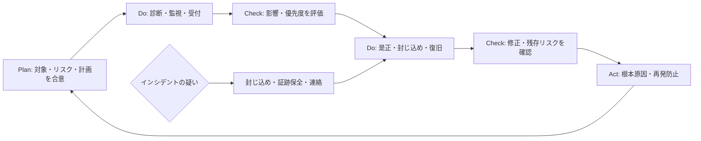

# セキュリティPDCA

脆弱性対応とインシデント対応は、発見して終わりではありません。根拠を残した優先度判断、対応確認、再発防止の効果測定までを継続して行います。

| 段階 | 判断・記録すること | 主なテンプレート |
| --- | --- | --- |
| Plan | 対象、責任、診断範囲、リスク基準、例外基準 | 運用計画、診断計画 |
| Do | 検知内容、事実、影響範囲、対応活動 | 実施記録、脆弱性台帳、インシデント記録 |
| Check | 優先度、修正確認、指標、残存リスク | トリアージ、状況報告 |
| Act | 根本原因、予防策、責任者、効果確認日 | 再発防止計画、振り返り |

脆弱性の深刻度スコアだけで優先順位を決めず、資産の重要度、到達可能性、公開・悪用状況、代替策、業務影響を記録して判断します。
