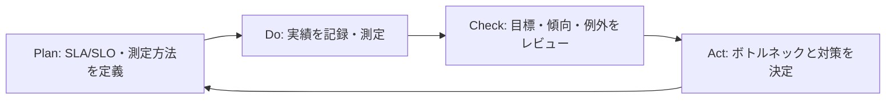

# セキュリティ運用におけるSLA/SLO

SLA（Service Level Agreement）は、提供者と利用者・関係者の間で合意する対応水準です。SLO（Service Level Objective）は、運用チームが継続的に追う目標値です。SLO未達がただちにSLA違反を意味するとは限らないため、対象、測定方法、除外条件、通知・エスカレーションを明確にします。

| 区分 | 目的 | 例 |
| --- | --- | --- |
| SLA | 合意した責任・対応水準を明確にする | 高優先度の脆弱性を所定の期間内に評価・対応する |
| SLO | チームの改善目標を定量的に追う | 期限内対応率、初動評価までの時間、再発防止策の完了率 |
| 指標 | SLA/SLOの状態を測定する値 | 対象件数、期限内完了件数、初動までの経過時間 |

## 設計時の原則

1. 優先度別に対象と起点を定義します。例: 検知時刻、受付時刻、トリアージ完了時刻のどれを使うか。
2. 「対応」の意味を分けます。評価、暫定緩和、恒久修正、修正確認を同じ期限として扱いません。
3. 保守時間、外部依存、承認待ち、緊急例外などの除外条件と記録方法を合意します。
4. SLO未達時は、個人評価ではなく、ボトルネック・資源・手順・自動化の改善材料として扱います。
5. SLAまたはSLOを変更する場合は、リスク、根拠、承認者、適用開始日を残します。

## PDCAとの関係

SLA/SLOは、脆弱性管理台帳とインシデント記録の時刻・状態を基に集計できます。ただし、集計のために個人情報や機密の詳細を公開用テンプレートへ記載しないでください。
